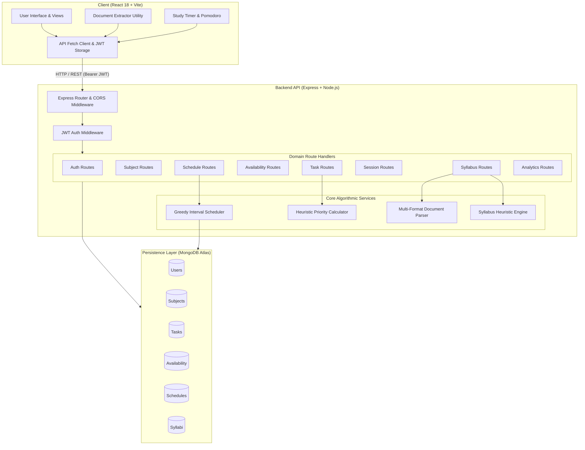
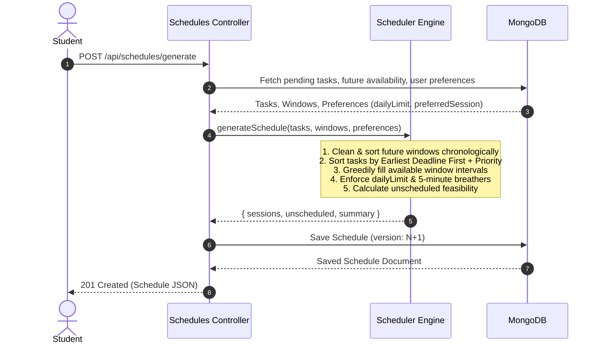
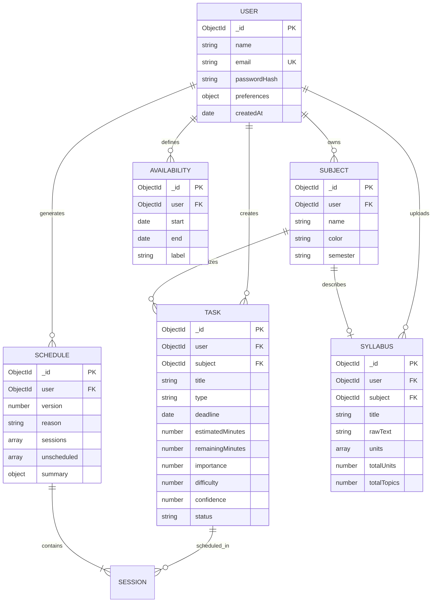
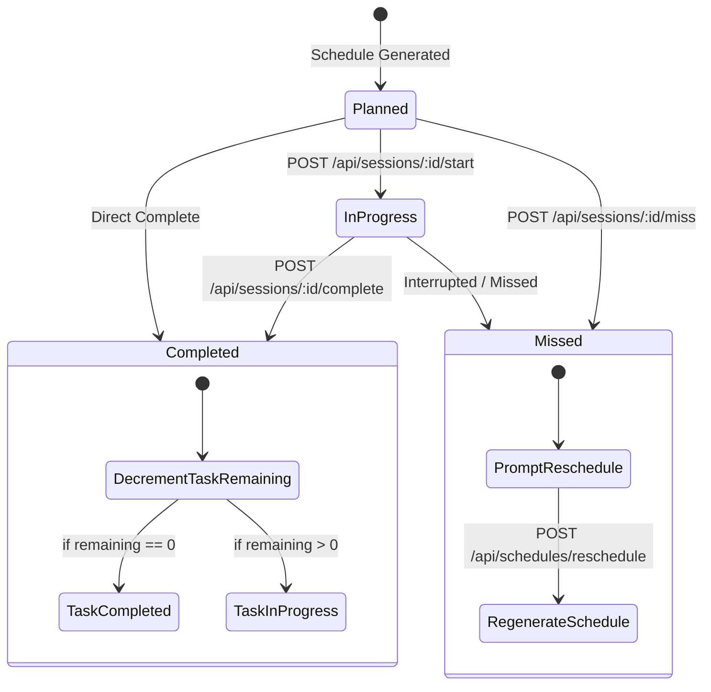
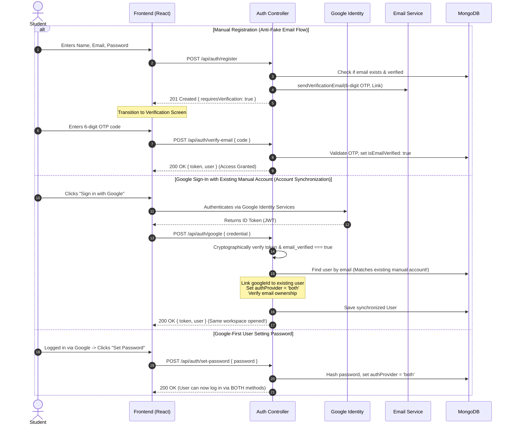

# StudyPilot — System Architecture & Design Documentation

## 1. Executive Summary

**StudyPilot** is an intelligent, full-stack adaptive study planner engineered for university students. Unlike static calendar apps or basic to-do lists, StudyPilot dynamically generates non-overlapping study sessions inside student-defined availability windows based on multi-factor heuristic priority scores, deadline urgency, difficulty ratings, and personal workload preferences.

---

## 2. High-Level System Architecture

StudyPilot follows a decoupled client-server architecture:
- **Frontend Client**: Single-page application (SPA) built with React 18, Vite, and Lucide React icons.
- **Backend API**: RESTful Express service running on Node.js (ES Modules) connecting to MongoDB via Mongoose.
- **Engines & Parsers**: Custom greedy interval scheduling algorithm, document text extractor (PDF, DOCX, Markdown, Text), and syllabus heuristic parser.

---

## 3. Core Algorithms & Mathematical Formulations

### 3.1 Multi-Factor Heuristic Priority Scoring

Every study task is evaluated against four distinct cognitive and temporal dimensions to produce a normalized priority score $S \in [0.0, 1.0]$:

$$\text{Priority} = (0.35 \times \text{Urgency}) + (0.30 \times \text{Importance}) + (0.20 \times \text{Difficulty}) + (0.15 \times (1 - \text{Confidence}))$$

#### Factor Weights & Normalization:
1. **Urgency ($35\%$)**:
   - Calculated relative to deadline: $\text{hoursLeft} = \frac{\text{deadline} - \text{now}}{3,600,000}$.
   - Overdue tasks ($\text{hoursLeft} \le 0$) receive maximum urgency ($1.0$).
   - Horizon: Evaluated across a 14-day sliding window ($336\text{ hours}$):
     $$\text{Urgency} = \max\left(0, \min\left(1, 1 - \frac{\text{hoursLeft}}{336}\right)\right)$$
2. **Importance ($30\%$)**:
   - Explicit user rating between $1$ and $5$, normalized to $[0.2, 1.0]$: $\frac{\text{importance}}{5}$.
3. **Difficulty ($20\%$)**:
   - Cognitive complexity rating between $1$ and $5$, normalized to $[0.2, 1.0]$: $\frac{\text{difficulty}}{5}$.
4. **Confidence Gap ($15\%$)**:
   - Inverted confidence rating: $\left(1 - \frac{\text{confidence}}{5}\right)$. Tasks where the student feels least confident receive higher scheduling priority.

---

### 3.2 Greedy Interval Scheduling Engine

The scheduling engine allocates discrete focus study sessions strictly into future student availability windows:

#### Key Scheduling Constraints:
- **Earliest Deadline First (EDF) with Priority Secondary Key**: Tasks are sorted primarily by deadline, and tie-broken by priority score.
- **Deadline Boundary Enforcement**: Sessions cannot be scheduled after the task's deadline ($T_{\text{end}} \le \text{deadline}$).
- **Daily Study Cap**: Enforces `preferences.dailyLimitMinutes` per calendar day to protect against burnout.
- **Session Duration Clamping**: Sessions target `preferredSessionMinutes` (default: 50 min), with a minimum viable session block of 15 minutes.
- **Breather Intervals**: A mandatory 5-minute recovery buffer is placed between consecutive study sessions.
- **Gap-Filling**: The scheduler fills vacant intervals between previously booked blocks before appending to the window tail.
- **Unscheduled Tracking**: Any unmet study minutes are recorded with concrete root causes (e.g. deadline passed, insufficient availability).

---

### 3.3 Document Extraction & Syllabus Parsing Pipeline

StudyPilot features automated syllabus processing capable of parsing course syllabi into structured study tasks:

```mermaid
flowchart LR
    Upload[Document Upload: PDF / DOCX / TXT / MD] --> Extractor[docParser.js: Text Extractor]
    Extractor --> Cleaner[Clean whitespace & formatting]
    Cleaner --> RegexParser[syllabusParser.js: Unit Header Regex & Partitioning]
    RegexParser --> Heuristics[Keyword Heuristic Analysis: Difficulty & Key Terms]
    Heuristics --> StructUnits[Structured Units & Topics]
    StructUnits --> TaskGen[Automated Task Generator: /create-tasks]
    TaskGen --> StudyTasks[Actionable Tasks with Staggered Deadlines]
```

1. **Document Ingestion**:
   - `pdf-parse`: Extracts text from PDF course outlines, stripping pagination headers.
   - `mammoth`: Extracts raw text streams from `.docx` files.
   - Client-side FileReader: Instantly reads plain `.txt` and `.md` files without network overhead.
2. **Structural Partitioning**:
   - Detects unit headers via regex: `^(?:unit|module|chapter|part|section)\s*[-:–—\s]*([0-9ivxlcdm]+)`.
   - Fallback chunking: If no unit markers exist, partitions content into logical 3–5 units.
3. **Difficulty Heuristics**:
   - Scans text for academic keywords (e.g., *distributed, asymptotic, cryptography, optimization* vs. *introduction, overview, fundamentals*) to classify unit difficulty into `Easy`, `Medium`, or `Hard`.
4. **Automated Task Conversion**:
   - Translates units into tasks, distributing deadlines over subsequent weeks (`+5d, +10d, +15d...`) with estimated minutes based on topic density.

---

## 4. Entity Relationship Diagram (Data Schema)

---

## 5. Session State Lifecycle & Adaptive Rescheduling

Study sessions and tasks adhere to deterministic state transitions:

- When a session is **completed**, its `actualMinutes` are deducted from the associated Task's `remainingMinutes`.
- If a session is **missed**, the task's remaining minutes remain unfulfilled; the student is prompted to trigger **Adaptive Recovery Rescheduling** (`POST /api/schedules/reschedule`), reallocating the missed study time into subsequent free windows.

---

## 6. Authentication Architecture & Account Synchronization

StudyPilot guarantees that all student accounts represent verified identities and allows students to access the same workspace seamlessly via either **Google OAuth 2.0** or **traditional email & password**.

